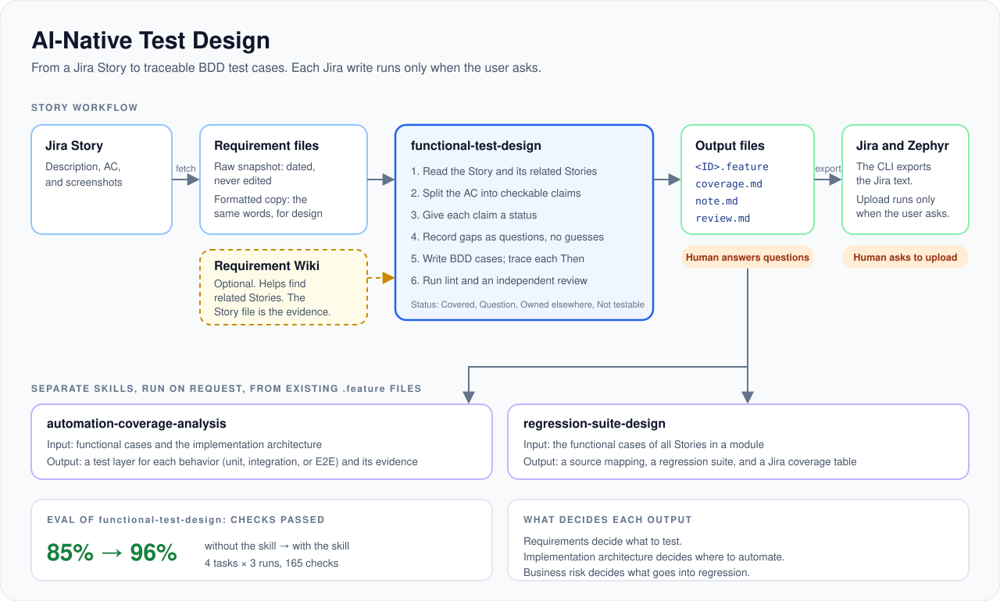

# AI-Native Test Design

Agent skills that turn a Jira Story into traceable BDD test cases. The agent
splits the AC into checkable claims, and each `Then` traces back to one claim.
It records requirement gaps as questions and does not guess. Two separate
skills use the cases to recommend test layers and to build release regression
suites. Jira writes run only when the user asks. In the evaluation, the agent
passed 96% of the checks with the skill and 85% without it. The skills run in
Claude Code, Codex, and Gemini CLI.



## What is inside

| Part                                                                 | Input                                                | Output                                                            |
| -------------------------------------------------------------------- | ---------------------------------------------------- | ----------------------------------------------------------------- |
| [functional-test-design](skills/functional-test-design/)             | Story, AC, notes, and screenshots                    | BDD `.feature` cases, requirement questions, and an AC trace      |
| [automation-coverage-analysis](skills/automation-coverage-analysis/) | Functional cases and the implementation architecture | A recommended test layer for each case                            |
| [regression-suite-design](skills/regression-suite-design/)           | The functional cases of a module                     | User journeys for release regression, plus high-risk scenarios    |
| [jira cli](skills/testcase-agent-cli/)                               | A Story ID and the cases                             | A dated requirement snapshot, Jira text, and an upload on request |
| [Requirement Wiki](wiki/README.md)                                   | Stories and notes                                    | Linked topic pages that agents search for context                 |

## Contents

1. [How it works](#how-it-works)
2. [Quick start](#quick-start)
3. [Requirement Wiki](#requirement-wiki)
4. [Evaluation](#evaluation)
5. [Further reading](#further-reading)

## How it works

Three rules guide the skills:

- Requirements guide test design.
- Implementation architecture guides automation test layers.
- Business risk guides regression selection.

The normal Story workflow has these steps:

1. The CLI fetches the Story into a dated raw snapshot. Nobody edits it.
2. Someone makes a formatted copy with the same words. A human reviews it.
3. `functional-test-design` reads the Story and its related Stories. It splits
   the AC into checkable claims in `coverage.md` and gives each claim a status:
   Covered, Question, Owned elsewhere, or Not testable.
4. The agent records each gap or conflict as a question in `note.md`. It does
   not guess.
5. The agent writes the `.feature` file. Each `Then` traces to a claim.
6. Lint checks the feature, the trace, and the overlap with other Stories.
7. A reviewer agent in a new context checks the cases against the source text.
   Its result goes to `review.md`.
8. The CLI exports the Jira text. Upload to Jira and Zephyr runs only when the
   user asks.

A human stays in control. The human reviews the formatted copy, answers the
questions in `note.md`, and asks for each Jira write. Local checks never write
to Jira.

`automation-coverage-analysis` and `regression-suite-design` are separate
skills. They run only when the user asks, and they read existing `.feature`
files.

The reviewed BDD cases are the input for
[ai-native-ui-automation](https://github.com/DerrickDeng/ai-native-ui-automation).

## Quick start

1. Clone the repository. Open it in Claude Code, Codex, or Gemini CLI.
2. Give the agent the Story ID and the reviewed requirement files. Include the
   referenced screenshots and related Stories.
3. Ask the agent to run the skill. For example:

   ```text
   Use functional-test-design to design BDD test cases for <Story ID>
   from its reviewed requirement files. Record requirement issues and
   questions, then validate and independently review the output.
   ```

4. Review the cases. Answer the requirement questions.

For test layer recommendations, give the agent the functional cases and the
implementation architecture. For release regression, give it the functional
cases of the module.

To try the workflow without Jira, use the synthetic
[online-store example](examples/online-store/) and the
[five-minute walkthrough](docs/usage.md#five-minute-walkthrough). The
[usage guide](docs/usage.md) has the local checks, the commands, and the Jira
setup.

## Requirement Wiki

A business rule often spans several Stories and notes. The Requirement Wiki
uses OpenViking to put them into linked topic pages with an index.

- **Find requirements:** Search with a business question. Get the related
  Stories and rules.
- **Connect rules:** Get the prerequisites and the behavior that other Stories
  describe.
- **Give context to agents:** The UI automation step implementor gets the
  business rules that a step needs, not the full collection.

Each rule links to its source Story or note. The Story file stays the evidence.
For test design, the Wiki only helps to find related Stories, and the agent
then reads each Story file.

The [Requirement Wiki guide](wiki/README.md) has the setup, the search, and an
example build.

## Evaluation

On 2026-10-09, each task ran 3 times with the skill and 3 times without it. The
percentage is the share of checks that passed. The sample is small, so it is
not a task success rate.

| Skill                  | Without the skill | With the skill      | Sample           |
| ---------------------- | ----------------- | ------------------- | ---------------- |
| functional-test-design | 141 / 165 (85%)   | **159 / 165 (96%)** | 4 tasks × 3 runs |

The skill adds the most on the hard tasks. It records each gap and conflict as
a question. It does not retest rules that another Story owns. Its independent
review quotes the source text.

`npm test` runs 66 deterministic tests for the CLI, lint, AC trace, and Jira
adapter. All pass.

The [evaluation results](docs/evaluation/results.md) give each task, the agent
time, and the limits.

## Further reading

- [Usage guide](docs/usage.md): Jira setup, commands, checks, and skill
  maintenance.
- [Requirement Wiki](wiki/README.md): requirement search and context for
  agents.
- [Architecture](docs/architecture.md): responsibilities and data flow.
- [Repository rules](AGENTS.md): source requirements and quality checks.
- [Public-release checklist](docs/public-release-checklist.md): how to prepare
  a clean public snapshot.
